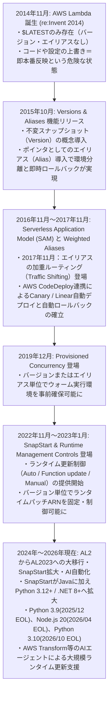
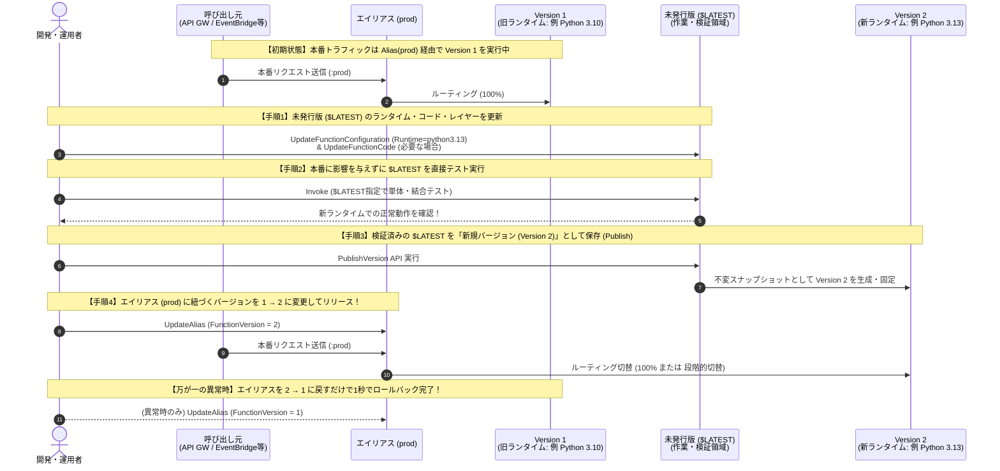

# AWS Lambda ランタイム更新におけるエイリアス（Alias）＆バージョン（Version）活用完全ガイド
## 〜登場の歴史・小学生にもわかる仕組み・未発行版（`$LATEST`）からの新バージョン保存とエイリアス切替方式の徹底評価〜

---

## 目次

1. [エグゼクティブサマリー（結論と総合評価）](#1-エグゼクティブサマリー結論と総合評価)
2. [小学生にもわかる！Lambdaの「バージョン」「エイリアス」「ランタイム更新」超入門](#2-小学生にもわかるlambdaのバージョンエイリアスランタイム更新超入門)
3. [登場の歴史と背景・なぜエイリアス機能が必要になったのか？（2014年〜2026年最新動向）](#3-登場の歴史と背景なぜエイリアス機能が必要になったのか2014年2026年最新動向)
4. [エイリアス機能とバージョン機能の技術的仕組みの完全整理](#4-エイリアス機能とバージョン機能の技術的仕組みの完全整理)
5. [【方式評価】未発行版（`$LATEST`）を新規バージョンとして保存し、エイリアスを変更してリリースする方式の徹底評価](#5-方式評価未発行版latestを新規バージョンとして保存しエイリアスを変更してリリースする方式の徹底評価)
6. [実践！エイリアスを用いたランタイム更新のステップバイステップ手順と即時ロールバック](#6-実践エイリアスを用いたランタイム更新のステップバイステップ手順と即時ロールバック)
7. [現場でハマる「8大落とし穴（トラップ）」と対策（権限・トリガー・IaC・SDK・レイヤー）](#7-現場でハマる8大落とし穴トラップと対策権限トリガーiacsdkレイヤー)
8. [【2026年最新】AWS Lambda ランタイムサポート期限（EOL）と最新機能動向](#8-2026年最新aws-lambda-ランタイムサポート期限eolと最新機能動向)
9. [実務導入・移行用チェックリスト](#9-実務導入移行用チェックリスト)

---

## 1. エグゼクティブサマリー（結論と総合評価）

### 1.1 結論ファースト：このリリース方式はどう評価されるか？

AWS Lambdaのランタイム更新（例：Python 3.10 → Python 3.13、Node.js 20 → Node.js 22/24 等）において、**「バージョン未発行版（`$LATEST`）でランタイムを更新・検証したうえで新規バージョンとして保存（Publish）し、エイリアス（Alias）に紐づくバージョン番号を変更して新バージョンのLambdaをリリースする方式」**は、AWS公式のWell-Architectedフレームワークおよびエンタープライズ実務において**最も推奨される王道（ベストプラクティス）のリリース方式（総合評価：Sランク）**です。

| 評価項目 | 評価ランク | 評価理由の要点 |
| :--- | :---: | :--- |
| **1. リリース安全性（本番保護）** | **S（極めて高い）** | 作業中の `$LATEST` を本番トラフィックから完全に隔離できるため、設定変更途中の不整合が本番へ一切影響しない。 |
| **2. 事前検証の確実性** | **S（極めて高い）** | 本番エイリアス（`prod`）を旧バージョンに向けたまま、`$LATEST` や検証用エイリアスで新ランタイムの動作を100%事前確認できる。 |
| **3. 切替の即時性（ゼロダウンタイム）** | **S（極めて高い）** | エイリアスのポインタ（向き先バージョン番号）を変更するだけで、ダウンタイムなしで瞬時に新ランタイムへ切り替わる。 |
| **4. ロールバック（切り戻し）速度** | **S（極めて高い）** | 万が一新ランタイムで不具合が出ても、エイリアスの向き先を旧バージョン番号に戻すだけで**数秒以内**に完全復旧できる。 |
| **5. 段階的リリース（カナリア）拡張性** | **S（極めて高い）** | エイリアスの「加重ルーティング（Weighted Alias）」機能を使えば、「まず新ランタイムに5%だけ流す」といった安全な段階移行が可能。 |
| **6. 呼び出し元（上位システム）への非侵襲性** | **A（条件付きS）** | すでに呼び出し元（API Gateway等）が「エイリアスARN」を参照していれば呼び出し元の変更はゼロ。**※初回導入時のみ呼び出し元の確認が必要。** |
| **7. IaC（Terraform / CloudFormation）親和性** | **B+（設計注意）** | コンソール手動操作とIaCを混在させると状態ドリフト（先祖返り）が起きるため、管理境界の明確化が必要。 |
| **総合評価** | **S（最推奨）** | **本番環境におけるLambdaランタイム更新の標準・最適解。特にロールバックの速さと環境の不変性（イミュータビリティ）において他方式を圧倒する。** |

---

### 1.2 「バージョン未発行版のLambda」という言葉の2つの文脈と重要ポイント

実務において「バージョン未発行版のLambdaを新規バージョンとして保存し、エイリアスでリリースする」という場合、以下の**2つのケース**が存在します。どちらのケースかで初回作業の注意点が大きく異なります。

1. **ケースA：すでに本番で「エイリアス運用」を行っており、AWS仕様上の未発行版（`$LATEST`）を使って新バージョンを作るケース**
   - 呼び出し元（API GatewayやEventBridgeなど）はすでに `arn:aws:lambda:...:function:my-func:prod`（エイリアスARN）を呼んでいる状態。
   - この場合、`$LATEST` のランタイムを更新 → 新バージョン（例：`v2`）として保存 → エイリアス `prod` の向き先を `v1` から `v2` に変えるだけで、**呼び出し元には一切手を触れずに無停止でランタイム更新が完了**します。
2. **ケースB：これまでバージョンを一度も発行せず（`$LATEST` 直参照で）本番運用していたLambdaに、今回からバージョン＋エイリアス方式を導入するケース**
   - 呼び出し元が `arn:aws:lambda:...:function:my-func`（エイリアスなしの関数ARN＝実質 `$LATEST`）を呼んでいる状態。
   - **【最重要の注意点】** ただバージョンを発行してエイリアスを作っただけでは、**呼び出し元は引き続き `$LATEST` を呼び続けてしまいます**。
   - したがって初回のみ、①現行の旧ランタイム状態を `v1` として保存し、②エイリアス `prod` を作成して `v1` に紐付け、③呼び出し元の向き先をエイリアスARN（`:prod`）へ切り替え（＋リソースベースポリシーの付与）、④その後に `$LATEST` を新ランタイムへ更新して `v2` を発行し、エイリアスを `v1` → `v2` へ切り替える、というステップを踏む必要があります。一度この形を作れば、次回以降のランタイム更新はケースAと同じく一瞬で終わります。

---

## 2. 小学生にもわかる！Lambdaの「バージョン」「エイリアス」「ランタイム更新」超入門

難しいクラウドの言葉を使う前に、**「大人気ハンバーガーショップ（レストラン）のキッチンと看板」**に例えてみましょう！小学生でも5分で仕組みが完全にわかります。

### 2.1 登場人物（4つのキーワード）の例え話

| AWS Lambdaの用語 | レストランでの例え | 小学生向けのわかりやすい説明 |
| :--- | :--- | :--- |
| **Lambda（ラムダ）関数** | **自動でお料理を作るロボットシェフ** | お客さんから注文が来たら、書かれたレシピ通りに一瞬でハンバーガーを作ってくれるロボットです。 |
| **ランタイム（Runtime）** | **キッチンの調理器具・オーブン（作業台）** | ロボットシェフが使う「Pythonオーブン」や「Node.jsフライヤー」などの調理マシンです。古くなるとメーカーの修理サポートが終わってしまうので、数年に一度、新しい型番（例：Python 3.10型 → Python 3.13型）に交換しなければなりません。 |
| **`$LATEST`（バージョン未発行版）** | **鉛筆で書き直せる「試作ノート（実験キッチン）」** | シェフがいつでも消しゴムで消して書き直せる「下書き用のレシピノート」と実験キッチンです。常に1つしかありません。 |
| **バージョン（Version 1, 2, 3...）** | **ラミネート加工した「完成レシピカード（番号付き）」** | 試作ノート（`$LATEST`）がうまくできたら、コピー機で印刷してプラスチックでラミネート加工し、「1番」「2番」と番号をつけたカードです。**一度ラミネートしたら、二度と文字を書き換えることはできません（不変・イミュータブル）。** 「どのオーブン（ランタイム）を使うか」もこのカードに一緒に印刷されて固定されます！ |
| **エイリアス（Alias）** | **お店の入り口にある「『本日の看板メニュー』の矢印ボード」** | お客さん（注文窓口）が見る看板です。看板には『本番用（prod）』と書いてあり、その横に**「今は【1番】のレシピカードで作っています」という付け替え可能な磁石の矢印**がついています。 |

---

### 2.2 もし「バージョン」も「エイリアス」もなかったらどうなる？（昔の失敗談）

もし、お店に「ラミネートした完成カード（バージョン）」も「看板（エイリアス）」もなく、**「鉛筆書きの試作ノート（`$LATEST`）」1冊だけ**でお店を営業していたらどうなるでしょうか？

1. **営業中にオーブン（ランタイム）を入れ替えると大パニック！**
   - お客さんが次々に注文している最中に、キッチンのオーブンを最新型に交換したら、「あれ？新しいオーブンだと焦げちゃった！」となった瞬間、**お店に来ているお客さん全員に焦げたハンバーガーが出されてしまいます。**
2. **元に戻したくても、前の設定を忘れて戻せない！**
   - 鉛筆書きのノート（`$LATEST`）を消しゴムで消して書き換えてしまったので、「前のオーブンの温度設定って何だっけ！？」と慌てても、すぐには元に戻せません。

---

### 2.3 エイリアスとバージョンを使うと、どうして安全なの？

今回評価する**「未発行版（`$LATEST`）を新しいバージョンとして保存し、エイリアスを切り替える方式」**は、レストランで言うと次の4ステップです。

```
【ステップ1：今の味を「1番カード」にラミネート保存！】
  今の試作ノート（古いオーブン用）を印刷して、ラミネートカード「バージョン1」として保存します。
  お店の看板『本番（prod）』の矢印を「バージョン1」に向けておきます。
  → お客さんには今まで通り「バージョン1」の安全なハンバーガーが出続けます。

【ステップ2：実験キッチン（$LATEST）で新しいオーブンに交換して味見！】
  お客さんからは見えない「試作ノート（$LATEST）」のオーブンを最新型（新ランタイム）に変えます。
  店長が試食（テスト）して、「よし、新しいオーブンでもバッチリ美味しいぞ！」と確認します。
  ※この間も、表のお客さんには「バージョン1」のハンバーガーが普通に出ています。

【ステップ3：新しい設定を「2番カード」にラミネート保存！】
  試作が成功した `$LATEST` を印刷して、ラミネートカード「バージョン2（新オーブン付き）」を作ります。

【ステップ4：看板（エイリアス）の磁石の矢印を「1番」から「2番」へパチッと付け替える！】
  お店の看板『本番（prod）』の矢印を「バージョン1」から「バージョン2」へ付け替えます。
  → この瞬間から、注文はすべて新しい「バージョン2」で作られます！
  → もし万が一、お客さんから「なんか味が違う！」と言われたら？
     看板の矢印を「バージョン2」から「バージョン1」へパチッと戻すだけ！たった1秒で元の味に戻せます！
```

さらに、**「まずは10人中1人（10%）のお客さんだけ『バージョン2』を出してみて、残りの9人（90%）には『バージョン1』を出す」**という魔法の振り分け（加重エイリアス／カナリアリリース）も、看板の設定ひとつでできちゃいます！

---

## 3. 登場の歴史と背景・なぜエイリアス機能が必要になったのか？（2014年〜2026年最新動向）

AWS Lambdaのエイリアス機能とランタイム管理がなぜ現在の形に進化したのか、その歴史的経緯を紐解くと、サーバーレス運用における本質的な課題と設計思想が明確に見えてきます。

### 3.1 進化のタイムライン（2014年〜2026年）



---

### 3.2 時代ごとの背景と「なぜ必要になったのか」の深掘り

#### 第1期：黎明期の苦悩（2014年11月〜2015年9月）—「`$LATEST` しかなかった時代」の4大課題
2014年11月のAWS re:InventでAWS Lambdaが発表された当初、Lambda関数にはバージョン管理の仕組みがなく、現在の **`$LATEST` に相当する単一の書き込み可能な領域**しか存在しませんでした。そのため、当時の開発現場では以下の**4つの深刻な問題**が頻発していました。

1. **本番環境の即時破壊リスク（ミュータブル問題）**
   - 開発者が新しいコードをアップロードしたり設定を変更したりすると、その瞬間に稼働中の関数が直接上書きされ、テスト未完了の状態がそのまま本番トラフィックを処理してしまう事故が多発しました。
2. **ロールバック（切り戻し）の不確実性と遅延**
   - 更新後にバグやランタイム不整合が発覚した場合、手元のGitやS3から古いZIPパッケージを探し出し、環境変数やメモリ設定も古い記憶や記録を頼りに手動で再設定・再アップロードする必要がありました。「コードは戻したが設定値を戻し忘れた」という二次災害も起きていました。
3. **環境分離のための「関数名の乱立」**
   - 開発（dev）・検証（stg）・本番（prod）を分けるために、`my-func-dev`, `my-func-stg`, `my-func-prod` や `my-func-v1`, `my-func-v2` のように別々のLambda関数を大量に作成するしかなく、IAMロールや監視アラーム、ロググループが爆発的に増殖しました。
4. **呼び出し元（イベントソース）の設定書き換え地獄**
   - もし `my-func-v1` から `my-func-v2` へ別関数として移行しようとすると、そのLambdaを呼び出しているAPI Gateway、S3イベント通知、SNS、モバイルアプリ等の設定をすべて書き換えて再デプロイする必要があり、切り替えのタイミングを合わせることが極めて困難でした。

#### 第2期：Versions & Aliases の誕生（2015年10月）—「不変（Immutable）と可変ポインタ（Alias）の分離」
こうした世界中のユーザーからの強い要望を受け、2015年10月（re:Invent 2015）に **「Versions（バージョン）」** と **「Aliases（エイリアス）」** が同時にリリースされました。
- **設計思想の核心**：
  - **Version（不変・イミュータブル）**：コードだけでなく、「どのランタイムか」「メモリは何MBか」「環境変数は何か」という**実行環境の構成一式を丸ごとカプセル化して番号を振り、二度と変更できないようにロックする**。
  - **Alias（可変ポインタ）**：呼び出し元には「エイリアス名（例：`prod`）」という変わらない窓口（ARN）だけを公開し、裏側でどのバージョン番号を実行するかはLambda側のポインタ切り替えだけで瞬時に制御できるようにする（**疎結合化／間接参照の原則**）。

#### 第3期：加重エイリアスとカナリアリリースの確立（2017年11月）
2017年11月には、1つのエイリアスに対して**2つのバージョンを紐付け、トラフィックの割合（重み付け：例 90% vs 10%）を指定できる「Traffic Shifting（加重エイリアス）」**が追加されました。
- これにより、従来は0か100かの切り替え（Blue/Green）しかできなかったものが、「新ランタイム・新バージョンにまず5%だけ本番通信を流し、CloudWatchアラームでエラーが出なければ10分後に100%にする（エラーが出たら自動で0%に戻す）」という**AWS CodeDeploy連携のカナリアデプロイ**が可能になりました。

#### 第4期：ランタイム管理制御（Runtime Management Controls）の登場（2022年11月〜2023年1月）
長らく、Lambdaの「メジャーなランタイム（例：Python 3.9 → 3.10）」はユーザーが選択するものの、「同じPython 3.9の中のマイナーパッチ更新（例：3.9.14 → 3.9.16やOSセキュリティパッチ）」はAWSが裏側で完全自動適用していました。
しかし、稀にAWS側のマイナーパッチ更新によって顧客コードの依存ライブラリが影響を受けるケースがあったため、2023年1月に **Runtime Management Controls（ランタイム管理制御）** が導入されました。
- これにより、**発行済みバージョンごと**にランタイムパッチの更新方式（`Auto` / `Function update` / `Manual`）や具体的な `RuntimeVersionArn` が紐づくようになり、「バージョンとエイリアスによるランタイム制御」の重要性がさらに高まりました。

#### 第5期：2025年〜2026年現在の最新状況 — なぜ今、エイリアスによるランタイム更新が最重要なのか？
2025年から2026年にかけて、AWS Lambdaは過去最大規模のランタイム世代交代期を迎えています。
- **ベースOSの世代交代（Amazon Linux 2 → Amazon Linux 2023）**：
  - Python 3.9 / 3.10 / 3.11 や Node.js 18 / 20（初期）がベースとしていた `Amazon Linux 2 (AL2)` から、Python 3.12 / 3.13 / 3.14、Node.js 20 / 22 / 24、Java 21 / 25 などが採用する `Amazon Linux 2023 (AL2023)` への移行が進んでいます。
  - AL2023ではコンテナイメージの軽量化のためプリインストールされているOSパッケージや共有ライブラリ（`glibc` バージョンや各種コマンド）が整理されており、**単なる言語バージョンアップ以上に事前検証と即時ロールバック手段（＝バージョン＋エイリアス）が不可欠**になっています。
- **サポート終了（EOL）の波**：
  - Python 3.9（2025年12月EOL）、Node.js 20（2026年4月EOL）、Python 3.10（2026年10月EOL）と、主要ランタイムのサポート終了が相次いでいます。

---

## 4. エイリアス機能とバージョン機能の技術的仕組みの完全整理

ランタイム更新を安全に実施するために、AWS Lambdaの内部で「`$LATEST`」「バージョン」「エイリアス」がどう動いているかを技術的に整理します。

### 4.1 3つの概念の比較とARN構造

| 区分 | `$LATEST`（バージョン未発行版） | 発行済みバージョン（Published Version） | エイリアス（Alias） |
| :--- | :--- | :--- | :--- |
| **本質的な役割** | 開発・編集用の作業領域（ドラフト） | 特定時点のコード＋設定の**不変スナップショット** | 特定バージョン（最大2つ）を指す**名前付きポインタ** |
| **識別子（Qualifier）** | `$LATEST`（省略時もこれになる） | `1`, `2`, `3` ...（単調増加する整数、再利用不可） | `prod`, `stg`, `dev`, `live` などの任意文字列 |
| **ARNの形式** | `arn:aws:lambda:region:acct:function:name` または末尾に `:$LATEST` | `arn:aws:lambda:region:acct:function:name:1` （末尾がバージョン番号） | `arn:aws:lambda:region:acct:function:name:prod` （末尾がエイリアス名） |
| **コードの変更** | **可能（Mutable）** | **不可（Immutable）** | コード自体は持たない（参照先バージョンのコードを実行） |
| **ランタイムの変更** | **可能（Mutable）** | **不可（Immutable）** ※ランタイム管理制御のみ例外操作あり | 参照先バージョンの変更によって結果的に切り替わる |
| **環境変数・メモリ変更** | **可能（Mutable）** | **不可（Immutable）** | 参照先バージョンの設定が使われる |
| **削除の可否** | 削除不可（関数自体を消さない限り存在） | 削除可能（ただし番号は欠番になり復活しない） | 削除・再作成・向き先変更がいつでも自由 |
| **追加料金** | なし（75GBのストレージ枠を消費） | なし（1バージョンごとにパッケージサイズ分のストレージ枠を消費） | **完全無料**（ポインタ情報のみのため容量消費もなし） |

---

### 4.2 【超重要】バージョン発行（PublishVersion）で「固定されるもの」と「固定されないもの」

「`$LATEST` を新規バージョンとして保存する」際、**何がそのバージョンの中に閉じ込められ（固定され）、何が外側に残るのか**を正確に把握しておく必要があります。

```
+-----------------------------------------------------------------------------------+
| Lambda 関数全体 (my-function)                                                     |
| ・予約済み同時実行数 (Reserved Concurrency) ※関数全体で共有                      |
| ・タグ (Tags)                                                                     |
|                                                                                   |
|  +-----------------------------------------------------------------------------+  |
|  | $LATEST (バージョン未発行版：編集可能)                                      |  |
|  |  ・コード (ZIP / コンテナイメージダイジェスト)                              |  |
|  |  ・ランタイム設定 (例: python3.13) ＆ RuntimeVersionArn                     |  |
|  |  ・アーキテクチャ (x86_64 / arm64)                                          |  |
|  |  ・環境変数 (Environment Variables) ＆ KMS暗号化キー                        |  |
|  |  ・メモリ (MB) / タイムアウト (秒) / エフェメラルストレージ (/tmp MB)       |  |
|  |  ・レイヤー (Lambda Layers の バージョン番号付きARN)                        |  |
|  |  ・実行ロール (IAM Execution Role ARN)                                      |  |
|  |  ・VPC設定 (Subnets / Security Groups) / X-Ray設定 / SnapStart設定          |  |
|  +-----------------------------------------------------------------------------+  |
|         │                                           │                             |
|         │ ① PublishVersion (旧時点)                 │ ② PublishVersion (更新後)   |
|         ▼                                           ▼                             |
|  +-------------------------------------+     +---------------------------------+  |
|  | Version 1 (不変スナップショット)    |     | Version 2 (不変スナップショット)|  |
|  | ・Runtime: python3.10 (固定)        |     | ・Runtime: python3.13 (固定)    |  |
|  | ・Code / Env / Layer / Memory (固定)|     | ・Code / Env / Layer / Memory   |  |
|  +-------------------------------------+     +---------------------------------+  |
|                     ▲                                       ▲                     |
|                     │ (旧ポインタ: ロールバック時は1秒で戻す) │ (新ポインタ: 切替) |
|                     +-------------------+-------------------+                     |
|                                         │                                         |
|                              +----------------------+                             |
|                              | Alias: "prod"        |                             |
|                              | (窓口ポインタ)       |                             |
|                              +----------------------+                             |
|                                         ▲                                         |
+-----------------------------------------│-----------------------------------------+
                                          │
                       呼び出し元（API Gateway / EventBridge / S3 等）
                       ※常に `...:function:my-function:prod` を呼び出す
```

#### バージョンごとに固定される項目（Immutable Snapshot）
一度バージョン（例：`Version 2`）を発行すると、以下の項目はそのバージョンに対して**永久に固定**されます。後から `$LATEST` をいくら書き換えても、`Version 2` の中身は1ミリも変わりません。
1. **関数コード**（デプロイパッケージZIP、またはコンテナイメージのSHA256ダイジェスト）
2. **ランタイム識別子**（例：`python3.10`、`python3.13`、`nodejs22.x` など）
3. **ランタイムバージョンARN**（同じ `python3.13` の中のどのパッチレベルか）
4. **CPUアーキテクチャ**（`x86_64` または `arm64`）
5. **ハンドラー名**（例：`lambda_function.lambda_handler`）
6. **メモリサイズ（MB）・タイムアウト（秒）・エフェメラルストレージ（`/tmp` サイズ）**
7. **環境変数（キーと値のペア）およびKMSキー設定**
8. **アタッチされたLambda Layers（レイヤーのバージョン番号付きARN）**
9. **IAM実行ロール（Execution Role ARN）**
10. **VPCネットワーク設定（サブネット・セキュリティグループ）**
11. **デッドレターキュー（DLQ）・X-Rayアクティブトレース・SnapStart有効化設定**

#### バージョンに固定されない項目（外側で管理される項目）
以下の項目はバージョンの中身ではなく、**「エイリアス」「特定のQualifier」「関数全体」**に対して設定されます。
1. **エイリアスのルーティング設定（どのバージョンに何%流すか）** → エイリアス自体の設定
2. **リソースベースポリシー（`aws_lambda_permission`：API GatewayやS3からの呼び出し許可）** → 関数本体、特定バージョン、または**特定エイリアスごと**に個別に付与される（※重要！7章で詳述）
3. **イベントソースマッピング（SQS, Kinesis, DynamoDB Streams, Kafkaのポーリング設定）** → どのARN（関数本体かエイリアスARNか）を対象にするかを設定する
4. **非同期呼び出し設定（Event Invoke Config：最大イベント経過時間、リトライ回数、On-Success/On-Failure送信先）** → `$LATEST`、バージョン、またはエイリアスごとに個別に設定される
5. **Provisioned Concurrency（プロビジョンド同時実行数）** → 特定のバージョンまたはエイリアスに対して設定される（`$LATEST` には設定不可）
6. **予約済み同時実行数（Reserved Concurrency）** → **関数全体で1つの枠**を全バージョン・全エイリアスで共有する

---

### 4.3 加重エイリアス（Weighted Alias）によるトラフィック分割の仕組み

エイリアスには、メインのバージョン（`FunctionVersion`）に加えて、**2つ目のバージョン（`AdditionalVersionWeights`）**を指定し、0.0〜1.0（0%〜100%）の重みを設定する機能があります。

```json
{
    "Name": "prod",
    "FunctionVersion": "1",
    "RoutingConfig": {
        "AdditionalVersionWeights": {
            "2": 0.10
        }
    }
}
```
上記のように設定すると、`prod` エイリアスへの呼び出しのうち **90%は Version 1（旧ランタイム）** へ、**10%は Version 2（新ランタイム）** へと自動的に振り分けられます。

> **【技術的制約・仕様上のポイント】**
> - 加重エイリアスでルーティング先に指定できる2つのバージョンは、どちらも**発行済みバージョン（数値）**である必要があります（`$LATEST` を加重ルーティングの片方に指定することはできません）。
> - また、加重ルーティングを行う2つのバージョンは**同じ実行ロール（IAM Role）とVPC設定**を持っていることが推奨・一部制約となります（CodeDeploy連携時など）。ランタイムが異なること（例：`Version 1` が `python3.10`、`Version 2` が `python3.13`）は**完全にサポートされており、問題なく動作します**。

---

### 4.4 ランタイム管理制御（Runtime Management Controls）との連携

AWS Lambdaには、同じメジャーランタイム内（例：`python3.13` の中）でのマイナーパッチ適用タイミングを制御する3つのモードがあります。これもバージョン・エイリアスと密接に連携します。

| モード名 | 動作の仕組み | バージョン・エイリアス運用との関係 |
| :--- | :--- | :--- |
| **1. Auto（自動・デフォルト）** | AWSがセキュリティパッチやバグ修正を含む最新ランタイムパッチへ自動的にアップデートする（2段階ロールアウト）。 | 発行済みバージョン（`Version 1`, `Version 2`）であっても、同じメジャーランタイム内のマイナーセキュリティパッチはAWSが自動で当てる。ただしメジャーバージョン（例: 3.10→3.13）が勝手に変わることは絶対にない。 |
| **2. Function update（関数更新時）** | コードや設定を変更（デプロイ）したタイミングでのみ、最新のランタイムパッチへ更新される。 | **バージョン・エイリアス運用と最も相性が良いモードの一つ。** 一度発行した `Version 1` のランタイムパッチレベルは、`Version 1` が書き換え不能であるため事実上ロックされ、新しく `$LATEST` を更新して `Version 2` を発行した時だけ新しいパッチが適用される。 |
| **3. Manual（手動・ARN固定）** | 特定の `RuntimeVersionArn` を直接指定して完全にピン留めする。自動更新は一切行われない。 | 厳格な金融・医療システムや、自動パッチで不具合が出た際の緊急回避用。ただしセキュリティパッチも止まるため、日常運用では `Auto` または `Function update` ＋エイリアス切替が推奨される。 |

---

## 5. 【方式評価】未発行版（`$LATEST`）を新規バージョンとして保存し、エイリアスを変更してリリースする方式の徹底評価

ここでは、ご質問の核心である**「バージョン未発行版（`$LATEST`）のLambdaを新規バージョンとして保存し、エイリアスに紐づくバージョンを変更して新バージョンのLambdaをリリースする方式」**について、多角的に評価します。

### 5.1 本方式のプロセス定義



---

### 5.2 他のランタイム更新方式との徹底比較マトリクス（4方式比較）

ランタイムを更新する際、現場で検討される代表的な4つの方式を比較します。

| 比較軸 | 【方式A】`$LATEST` 直接更新方式（バージョン・エイリアス不使用） | 【方式B】新バージョン保存＋エイリアス一括切替方式（Blue/Green）★本方式① | 【方式C】新バージョン保存＋加重エイリアス段階切替方式（Canary）★本方式② | 【方式D】別Lambda関数を新規作成＋上位リソース切替方式 |
| :--- | :--- | :--- | :--- | :--- |
| **概要** | `$LATEST` を直接本番利用し、その場でランタイム設定を上書き変更する | `$LATEST` でランタイム更新・検証後、新バージョンとして保存し、エイリアスの向き先を一括変更する | 方式Bに加え、エイリアスの重み付けで「10%→50%→100%」と段階的に切り替える | `func-py313` のような別関数を作り、API Gateway等の向き先設定を変更する |
| **本番への安全性** | **×（危険）** 更新した瞬間に未検証状態で本番反映される | **◎（極めて安全）** `$LATEST` で完全検証後に切替可能 | **◎＋（最高水準）** 少量のトラフィックで様子見ができる | **○（安全）** 別関数なので既存には影響しない |
| **コード＋ランタイム＋環境変数の同時変更時の整合性** | **×（不整合発生）** コード更新APIと設定更新APIのタイムラグ中にエラーが出る | **◎（完全一致）** 全て整った状態の `$LATEST` をバージョン化して一発で切り替えるため不整合ゼロ | **◎（完全一致）** バージョン単位でアトミックに切り替わる | **◎（完全一致）** 別関数として構築完了後に切り替えるため不整合なし |
| **ロールバックの速さと確実性** | **×（数分〜数十分）** 設定やコードを手動で戻す必要がありミスが起きやすい | **◎（1〜3秒）** エイリアスのバージョン番号を旧番号に戻すだけで100%元の状態に戻る | **◎（1〜3秒／自動可）** CloudWatchアラーム連動で自動ロールバックも可能 | **△（数分）** API Gatewayのデプロイやイベントソースの再設定が必要 |
| **呼び出し元（API GW等）の設定変更** | 不要（ただし危険） | **不要**（※既にエイリアス参照している場合） | **不要**（※既にエイリアス参照している場合） | **必要**（すべてのトリガー・IAM・監視設定を作り直す必要あり） |
| **ログ（CloudWatch Logs）の連続性** | 同一ロググループに出力 | **同一ロググループに出力**され、ログストリーム名に `[1]`, `[2]` とバージョンが明記されるため比較が容易 | **同一ロググループに出力**され、新旧バージョンのエラー率比較が極めて容易 | 別ロググループに分断されるため、移行前後の比較やアラーム管理が煩雑 |
| **操作・運用のシンプルさ** | 最も単純だが本番運用には不適 | **◎ シンプルかつ堅牢**（標準的な運用に最適） | **○ やや高度**（非べき等処理やセッション整合性の考慮が必要） | **× 非常に煩雑**（リソース管理コストが2倍になる） |
| **総合判定** | **非推奨（開発環境のみ）** | **★最推奨（標準の本番ランタイム更新方式）** | **★推奨（ミッションクリティカル・大規模トラフィック向け）** | **非推奨（関数分割などアーキテクチャ刷新時のみ）** |

---

### 5.3 本方式が圧倒的に優れている「5つの決定的な理由（メリット）」

#### ① 「コード更新」と「設定（ランタイム・レイヤー）更新」のタイムラグ問題（Race Condition）を完全に解消できる
AWS Lambdaの仕様上、「関数コードの更新（`UpdateFunctionCode`）」と「ランタイムやレイヤー、環境変数の更新（`UpdateFunctionConfiguration`）」は**別々のAPIコール**です。
もしエイリアスを使わずに `$LATEST` で直接本番運用していると、「ランタイムだけPython 3.13に変わったが、Python 3.13用の新しいコードやレイヤーへの更新が数秒遅れた」という**数秒間の不整合状態の間に来た本番リクエストがすべてエラー（500 Internal Server Error）**になります。
一方、本方式では **`$LATEST` 上でコード・ランタイム・レイヤー・環境変数をすべて変更し、内部状態が `Active` になるのを待ってから `PublishVersion` で1つのバージョンに固め、最後にエイリアスをパチッと切り替える**ため、**更新途中の不整合（中途半端な状態）が本番に露出する確率は0%（完全なアトミック切替）**になります。

#### ② 同一のLambda関数環境（IAMロール・VPC・環境変数）で本番切替前の実機テストができる
ランタイム更新で最も怖いのは、「テスト環境では動いたのに、本番のIAMロールや本番VPCサブネット、本番の環境変数と組み合わせたら動かなかった」という事象です。
本方式なら、本番のエイリアス `prod` は `Version 1`（旧ランタイム）を処理し続けながら、同じLambda関数内の `$LATEST`（または検証用エイリアス `candidate`）は**新ランタイム＋本番と同一のVPC/IAM環境**で待機しているため、テストイベントを投げて100%確実な事前動作確認ができます。

#### ③ 「1秒ロールバック」という最強の保険が手に入る
ランタイム更新では、稀に「特定の入力データパターンが来た時だけ、新しい言語バージョンの正規表現エンジンやJSONパーサー、同梱SDKの仕様変更で例外が出る」といった事象が本番リリース後に発覚することがあります。
このとき、旧ランタイムの状態が `Version 1` としてイミュータブル（不変）に保存されているため、エイリアスの向き先を `Version 2` から `Version 1` に戻すだけで、**ビルドや再アップロードを一切待つことなく、数秒で確実に元の正常状態へ復旧**できます。

#### ④ CloudWatch Logs / Metrics でバージョンごとの稼働状況を明確に追跡できる
Lambdaが実行されると、CloudWatch Logsのログストリーム名には `2026/10/17/[1]abcdef...` や `2026/10/17/[2]123456...` のように**角括弧 `[バージョン番号]` が自動的に付与**されます。
そのため、エイリアスを `Version 1` から `Version 2` に切り替えた瞬間から、`[2]` のログストリームが新しく作られ、「新ランタイムになってからメモリ使用量（Max Memory Used）や実行時間（Duration）、Init Duration（コールドスタート時間）がどう変化したか」をCloudWatch Logs Insightsで1ミリ秒単位で正確に比較評価できます。

#### ⑤ 呼び出し元（サービス利用者・他システム）に対して完全に透過的（ブラックボックス化）
API Gateway、Application Load Balancer (ALB)、EventBridge、S3、Step Functions、あるいは他部署のマイクロサービスが、エイリアスARN（`:prod`）を呼び出す構成になっていれば、Lambda側で何回ランタイムを更新してバージョン番号が `1 → 2 → 3 ... → 50` と進んでも、**呼び出し元の設定変更や再デプロイは未来永劫一切不要**です。

---

### 5.4 本方式を採用する際の「デメリット・制約事項」と評価

公平かつ厳密なエンジニアリング評価として、デメリット（トレードオフ）も明確に整理します。

| デメリット・注意点 | 影響度 | 発生メカニズム | 解決策・緩和策 |
| :--- | :---: | :--- | :--- |
| **1. 切替直後に初回コールドスタートが発生する** | 中 | エイリアスの向き先が `Version 1` から `Version 2` に変わると、AWS内部で `Version 2` 用の新しい実行環境（MicroVM）が新規起動するため、切り替え直後の最初のリクエスト群で初期化処理（Init）が走る。 | ・通常のWeb API等では数百ミリ秒〜数秒の初回遅延のみで大きな問題にはならない。<br/>・レイテンシ要件が極めて厳しい場合は、切替前に `Version 2`（またはエイリアス）で **SnapStart** または **Provisioned Concurrency** を有効化する、あるいは加重エイリアスで10%ずつ徐々にウォームアップさせながら切り替える。 |
| **2. 初回導入時のみ、呼び出し元がエイリアスARNを向いているか確認・修正が必要** | 高（初回のみ） | これまでバージョン未発行（`$LATEST` 直参照）で運用していた場合、呼び出し元が `:prod` なしの関数ARNを呼んでいるため、エイリアスを作っただけでは使われない。 | ・初回のみ、呼び出し元（API Gateway統合URIやEventBridgeターゲット等）を `:prod` エイリアスARNに変更し、`aws_lambda_permission` に `--qualifier prod` を追加する（詳細は第7章）。 |
| **3. IaC（Terraform等）との状態ドリフト管理** | 中 | コンソールやCLIで手動バージョン発行＋エイリアス切替を行うと、Terraformの `.tfstate` が記憶しているバージョン番号とズレが生じる。 | ・IaC側でエイリアスの `function_version` を `lifecycle { ignore_changes = [function_version] }` にするか、またはランタイム更新・バージョン発行自体をIaC（`publish = true`）経由で実行する（詳細は第7章）。 |
| **4. 過去バージョンの蓄積によるストレージ枠（75GB）消費** | 低 | バージョンを発行するたびに、その時点のコードパッケージサイズ分だけリージョンあたりのLambdaストレージ上限（デフォルト75GB）を消費する。 | ・直近の安定稼働バージョン（例：直近3〜5世代）を残し、不要になった古いバージョンは定期的に削除する（エイリアスが紐づいているバージョンは誤削除できないようAWS側で保護されるため安全）。 |

---

## 6. 実践！エイリアスを用いたランタイム更新のステップバイステップ手順と即時ロールバック

ここでは、実務でそのまま手順書として使えるレベルで、**AWSマネジメントコンソール手順**と**AWS CLIコマンド手順**の両方を体系的に示します。

### 6.1 シナリオ設定
- **対象Lambda関数名**: `order-processor-fn`
- **本番エイリアス名**: `prod`
- **現行ランタイム**: `python3.10`（Version `1` として稼働中、または現行 `$LATEST` をこれから Version `1` として保存）
- **新ランタイム**: `python3.13`（新規 Version `2` として発行し、`prod` エイリアスを切り替え）

---

### 6.2 ステップバイステップ実行手順

#### Step 1：【事前保護】現行（旧ランタイム）の状態がバージョン保存されているか確認・保存する
もし現在、まだ旧ランタイムのバージョンが発行されていない場合（または `$LATEST` と現行バージョンに差分がある場合）は、**必ずランタイムを変更する前に、現行の正常稼働状態を新規バージョン（例：`Version 1`）として保存（Publish）**し、本番エイリアス `prod` がその `Version 1` を向いている状態にします。

- **AWS CLIの場合**:
  ```bash
  # 1. 現行の $LATEST (旧ランタイム python3.10) を不変バージョンとして保存
  aws lambda publish-version \
    --function-name order-processor-fn \
    --description "Backup before runtime update: Python 3.10 stable"

  # 出力された Version 番号（例: "1"）を確認し、エイリアス prod が Version 1 を向いていることを確認（未作成なら作成）
  aws lambda get-alias \
    --function-name order-processor-fn \
    --name prod
  ```
- **コンソールの場合**:
  1. Lambda関数の画面を開き、**「バージョン」**タブをクリック。
  2. **「新しいバージョンを発行」**をクリックし、説明（例：`Python 3.10 現行安定版バックアップ`）を入力して**「発行」**。
  3. **「エイリアス」**タブを開き、本番用エイリアス（例：`prod`）が発行したバージョン番号（例：`1`）を指していることを確認します。

---

#### Step 2：未発行版（`$LATEST`）のランタイム（およびレイヤー・コード）を更新する
本番エイリアス `prod` が `Version 1`（旧ランタイム）を守っている状態で、編集領域である **`$LATEST`** のランタイムを新しいバージョンへ更新します。

> **【重要チェック】** PythonやNode.jsのC拡張などを含む **Lambda Layers（レイヤー）** を使用している場合は、新ランタイム（例：`python3.13`）向けにビルドされた新しいレイヤーバージョンへ同時に更新してください。

- **AWS CLIの場合**:
  ```bash
  # 1. (コード修正がある場合) $LATEST のコードを更新
  aws lambda update-function-code \
    --function-name order-processor-fn \
    --zip-file fileb://function-py313.zip

  # コード更新完了 (LastUpdateStatus = Successful) を待機
  aws lambda wait function-updated \
    --function-name order-processor-fn

  # 2. $LATEST のランタイムを python3.13 に変更（必要に応じてレイヤーも更新）
  aws lambda update-function-configuration \
    --function-name order-processor-fn \
    --runtime python3.13

  # 設定更新完了 (LastUpdateStatus = Successful) を待機
  aws lambda wait function-updated \
    --function-name order-processor-fn
  ```
- **コンソールの場合**:
  1. Lambda関数のトップ画面（`$LATEST` の編集画面）で**「コード」**タブを開く。
  2. 下部の**「ランタイム設定」**セクションにある**「編集」**ボタンをクリック。
  3. ランタイムのプルダウンから新しいランタイム（例：`Python 3.13`）を選択し、**「保存」**をクリック。
  4. 画面上部に「関数 order-processor-fn が正常に更新されました」と表示されるのを待ちます。

---

#### Step 3：未発行版（`$LATEST`）に対して新ランタイムの動作検証（テスト）を行う
まだ本番エイリアス `prod` は `Version 1`（旧ランタイム）で動いています。この安全な状態で、新ランタイムになった **`$LATEST`** を直接テスト実行し、エラーが出ないか・処理時間やメモリ消費に異常がないかを検証します。

- **AWS CLIの場合**:
  ```bash
  # Qualifier に $LATEST を指定してテストイベントを実行
  aws lambda invoke \
    --function-name order-processor-fn \
    --qualifier "\$LATEST" \
    --payload fileb://test-event.json \
    response.json

  # 実行結果とログの確認
  cat response.json
  ```
- **コンソールの場合**:
  1. 関数のトップ画面の**「テスト」**タブを開き、テストイベントを実行します（トップ画面からのテストは自動的に `$LATEST` に対して実行されます）。
  2. 実行結果が `Succeeded` になり、ログ出力に `ImportError` や `DeprecationWarning`、SDKエラー等が出ていないことを確認します。

---

#### Step 4：検証済みの未発行版（`$LATEST`）を「新規バージョン（例：`Version 2`）」として保存（Publish）する
`$LATEST` での検証が完了したら、この状態を不変のスナップショットとして新しいバージョンに保存します。

- **AWS CLIの場合**:
  ```bash
  # 検証済みの $LATEST (新ランタイム python3.13) を新規バージョンとして保存
  aws lambda publish-version \
    --function-name order-processor-fn \
    --description "Runtime updated to Python 3.13 (Verified)"
  ```
  - 出力された JSON の `"Version": "2"` と `"Runtime": "python3.13"` を確認します。
- **コンソールの場合**:
  1. 画面右上の**「アクション」**プルダウン（または「バージョン」タブ）から**「新しいバージョンを発行」**をクリック。
  2. バージョンの説明に `Python 3.13 ランタイム更新版（検証済）` と入力し、**「発行」**をクリック。
  3. 新しいバージョン番号（例：`バージョン 2`）が作成され、そのランタイムが `Python 3.13` として固定されたことを確認します。

---

#### Step 5：エイリアス（`prod`）に紐づくバージョンを変更して新バージョンをリリースする！
いよいよ本番リリースの瞬間です。エイリアス `prod` の向き先を `Version 1` から `Version 2` へ変更します。
ここでは **「パターンA：一括切替（Blue/Green）」** と **「パターンB：加重エイリアスによる段階的切替（Canary）」** の両方を選べます。

##### パターンA：一括切替（Blue/Greenリリース）の場合
- **AWS CLIの場合**:
  ```bash
  # エイリアス prod の向き先を Version 2 に一括変更
  aws lambda update-alias \
    --function-name order-processor-fn \
    --name prod \
    --function-version 2
  ```
- **コンソールの場合**:
  1. **「エイリアス」**タブを開き、`prod` を選択して**「編集」**をクリック。
  2. **「バージョン」**のプルダウンを `1` から `2` に変更し、**「保存」**をクリック。
  3. 即座にすべての本番トラフィックが `Version 2`（Python 3.13）へ切り替わります！

##### パターンB：加重エイリアスで10%だけ新バージョンに流す（カナリアリリース）の場合
- **AWS CLIの場合**:
  ```bash
  # まず 90% を Version 1、10% を Version 2 に振り分ける
  aws lambda update-alias \
    --function-name order-processor-fn \
    --name prod \
    --function-version 1 \
    --routing-config AdditionalVersionWeights={"2"=0.1}

  # CloudWatchメトリクスでエラーがないことを確認後、100% Version 2 へ完全切替
  aws lambda update-alias \
    --function-name order-processor-fn \
    --name prod \
    --function-version 2 \
    --routing-config AdditionalVersionWeights={}
  ```
- **コンソールの場合**:
  1. `prod` エイリアスの編集画面で、メインのバージョンを `1`（重み 90%）のままにし、**「追加バージョン」**で `2` を選択して重みに `10`（%）を入力して保存。
  2. 数分〜数十分間、CloudWatchのエラーメトリクスを監視し、問題なければメインバージョンを `2`（100%）、追加バージョンを「なし」にして保存します。

---

#### Step 6：【緊急時】万が一問題が発生した場合の「1秒ロールバック（切り戻し）」手順
新ランタイムへ切り替えた後、万が一予期せぬエラーやレイテンシ悪化が検知された場合は、**コードの再アップロードやランタイム設定の再編集は一切不要**です。エイリアスの向き先を `1` に戻すだけで完了します。

- **AWS CLIの場合**:
  ```bash
  # 1秒で旧ランタイム (Version 1) へ完全切り戻し！
  aws lambda update-alias \
    --function-name order-processor-fn \
    --name prod \
    --function-version 1 \
    --routing-config AdditionalVersionWeights={}
  ```
- **コンソールの場合**:
  1. **「エイリアス」**タブから `prod` の**「編集」**を開く。
  2. バージョンを `2` から `1` に戻して**「保存」**をクリック（所要時間：数秒）。

---

## 7. 現場でハマる「8大落とし穴（トラップ）」と対策（権限・トリガー・IaC・SDK・レイヤー）

エイリアスによるランタイム更新は極めて優れた方式ですが、周辺のAWSリソースやIaCとの連携を知らずに実施すると思わぬトラブルに遭遇します。現場で実際に発生する**8大落とし穴と完全な対策**をまとめます。

### 落とし穴①：呼び出し元が「エイリアスARN」ではなく「関数ARN（`$LATEST`）」を向いていた
- **事象**：一生懸命 `$LATEST` を更新して `Version 2` を作り、エイリアス `prod` を `Version 2` に切り替えたのに、実はAPI GatewayやEventBridgeのターゲット設定が `:prod` のついていない `arn:aws:lambda:...:function:order-processor-fn` になっていたため、Step 2で `$LATEST` を触った瞬間に本番が変わってしまっていた（しかもエイリアス切替が全く意味をなしていなかった）。
- **対策**：
  - **作業前に必ず「呼び出し元（トリガー）がどのARNを参照しているか」を確認**してください。
  - Lambdaコンソールの「設定」＞「トリガー」タブで、各トリガーに `エイリアス: prod`（または `Qualifier: prod`）の表示があるかを確認します。

### 落とし穴②：リソースベースポリシー（`aws_lambda_permission`）の `Qualifier` 漏れによる `403 AccessDenied`
- **事象**：API GatewayやS3、EventBridgeのターゲットを関数本体（`$LATEST`）からエイリアス `:prod` に変更したところ、呼び出し時に `AccessDeniedException (User is not authorized to perform: lambda:InvokeFunction on resource: ...:function:my-func:prod)` が発生して動かなくなった。
- **原因**：AWS Lambdaのリソースベースポリシー（実行許可）は、**「修飾子なし（関数本体）」と「修飾子あり（`:prod` エイリアス）」で別々のリソースとして厳密に判定**されます。`arn:aws:lambda:...:function:my-func` に対するInvoke許可しか付いていない場合、`:prod` エイリアスへのInvokeは拒否されます。
- **対策**：
  - エイリアスを呼び出すトリガーには、必ず **`--qualifier prod` を指定したリソースベースポリシー（Permission）** を付与してください。
  - 一度エイリアス `:prod` に対してPermissionを付与しておけば、今後エイリアスの中身を `Version 1 → Version 2 → Version 3` と何回変更しても、**Permissionの再設定は一切不要**です（これがエイリアスを使う最大のメリットの一つです）。

### 落とし穴③：Terraform / CloudFormation / AWS SAM との「状態ドリフト（先祖返り）」
- **事象**：AWSコンソールやCLIで手動で新バージョンを発行し、エイリアス `prod` を `Version 2` に切り替えてランタイム更新を完了させた。しかし数日後、別のメンバーがTerraform（`terraform apply`）を実行したところ、Terraformが管理していた古い設定（`runtime = "python3.10"`, `function_version = "1"`）で上書きされ、**旧ランタイムへ先祖返り**してしまった。
- **対策**：運用スタイルに合わせて以下の2パターンのいずれかに統一します。
  - **パターン1（IaC完全管理型・推奨）**：コンソールで手動変更するのではなく、Terraformコード上で `runtime = "python3.13"` と `publish = true` を設定して `terraform apply` を実行し、Terraform自身に新バージョン発行とエイリアス更新（`aws_lambda_alias.prod.function_version = aws_lambda_function.main.version`）を行わせる。
    ```hcl
    resource "aws_lambda_function" "main" {
      function_name = "order-processor-fn"
      runtime       = "python3.13" # ここを変更して apply すると新バージョンが自動発行される
      publish       = true         # 変更時に自動で PublishVersion を実行
      # ...
    }

    resource "aws_lambda_alias" "prod" {
      name             = "prod"
      function_name    = aws_lambda_function.main.arn
      function_version = aws_lambda_function.main.version # 最新発行バージョンへ自動追従
    }
    ```
  - **パターン2（インフラ枠とリリース分離型）**：Terraformでは関数とエイリアスの「器」だけを作り、`lifecycle { ignore_changes = [runtime, function_version] }` を設定するか、リリース作業完了後に必ずTerraformコード側の `runtime` とバージョン指定も同じ値に揃えてコミットし、`terraform plan` で差分ゼロ（No changes）を確認する。

### 落とし穴④：Amazon Linux 2 から Amazon Linux 2023 へのOS世代交代による影響
- **事象**：Python 3.9/3.10/3.11 や Node.js 18 から、Python 3.12/3.13/3.14 や Node.js 22/24、Java 21/25 へランタイムを更新した際、関数内で呼び出していたOSコマンド（例：`tar`, `gzip`, `find` 等）や共有ライブラリ（`.so` ファイル）が見つからずエラーになった。
- **原因**：ベースOSが `Amazon Linux 2 (AL2)` から `Amazon Linux 2023 (AL2023)` に変更されたため、プリインストールパッケージが最小限（Microdnfベース）にスリム化されており、`glibc` のバージョンも上がっています。
- **対策**：Step 3（`$LATEST` での事前テスト）にて、外部バイナリ呼び出し（`subprocess` / `child_process`）やネイティブライブラリ（`psycopg2`, `cryptography`, `numpy`, `pillow`, `sharp` 等）を通るパスを必ずテストしてください。

### 落とし穴⑤：ランタイム同梱のAWS SDK（boto3 / AWS SDK for JavaScript）や言語仕様の非互換
- **事象**：コードは1行も変えていないのに、ランタイムを上げただけでエラーになった。
- **代表例**：
  - **Node.js 24**：長年使われてきたコールバック形式のハンドラー（`exports.handler = (event, context, callback) => {}`）が廃止され、`async/await` 形式が必須化。
  - **Node.js 16以前 → 18以降**：ランタイム同梱のAWS SDKが `aws-sdk` (v2) から `@aws-sdk/client-*` (v3) へ完全移行。
  - **Python 3.12以降**：標準ライブラリから `distutils` や `imp` が削除。また同梱 `urllib3` が v2 系になったことによる一部オプションの挙動変化。
- **対策**：エイリアスを切り替える前の `$LATEST` 検証フェーズで、必ず実際のイベントペイロードを模したテストを実施してください。

### 落とし穴⑥：Lambda Layers（レイヤー）のC拡張バイナリ非互換
- **事象**：ランタイムを `python3.10` から `python3.13` に上げて新バージョンを発行したが、レイヤー（Layers）は `python3.10` 用のままにしていたため、C言語拡張を含むライブラリ（`pydantic-core`, `orjson`, `numpy`, `pandas`, `psycopg2` 等）の `import` 時に `ModuleNotFoundError` や `ImportError: cannot open shared object file` が発生した。
- **原因**：PythonやNode.jsのネイティブ拡張（`.cpython-310-x86_64-linux-gnu.so` 等）はマイナーバージョンごとにバイナリファイル名が異なります。また、レイヤーには「互換性のあるランタイム」の設定があります。
- **対策**：`Step 2` で `$LATEST` のランタイムを更新する際、**新ランタイム向けにビルドした新しいレイヤーバージョンを同時に `$LATEST` にアタッチ**してから、`Step 4` でバージョンを発行してください。新旧それぞれのレイヤーが `Version 1` と `Version 2` に個別に固定されるため、ロールバック時もレイヤーごと完璧に切り戻せます。

### 落とし穴⑦：Provisioned Concurrency（プロビジョンド同時実行）と SnapStart の切替時間
- **事象**：Provisioned Concurrency や SnapStart を有効化している関数で、新バージョン発行直後にエイリアスを切り替えたら、数分間プロビジョニングが完了せずスピルオーバー（オンデマンド実行）や遅延が発生した。
- **対策**：
  - **Provisioned Concurrency** をエイリアス（`prod`）に対して設定している場合、エイリアスの向き先バージョンを変更すると、AWSが裏側で新バージョン用のウォーム環境を確保し直します（数分かかります）。AWS CodeDeploy連携または段階的切替を使うと、新バージョンのProvisioned Concurrencyが準備完了してからトラフィックを移すことができます。
  - **SnapStart**（Java 11/17/21/25、Python 3.12+、.NET 8+ 対応）を有効にしている場合、`PublishVersion` を実行してからスナップショット作成が完了するまで1〜2分（状態が `Pending` → `Active` になるまで）かかります。**必ず新バージョンのステータスが `Active` になってからエイリアスを切り替えてください。**

### 落とし穴⑧：非同期呼び出し設定・SQSイベントソースマッピングの確認漏れ
- **事象**：SQSやKinesis、DynamoDB Streamsをトリガー（Event Source Mapping）にしている関数で、イベントソースマッピング側が関数本体（`$LATEST`）に紐づいていた。
- **対策**：SQS等のイベントソースマッピングでも `FunctionName` にエイリアスARN（`arn:aws:lambda:...:function:my-func:prod`）を指定可能です。エイリアスARNを指定しておけば、エイリアスの向き先を変えるだけでポーリング先のバージョンが自動的に切り替わります。

---

## 8. 【2026年最新】AWS Lambda ランタイムサポート期限（EOL）と最新機能動向

2026年10月現在の最新情報に基づく、主要マネージドランタイムのサポート期限（Deprecation Schedule）と推奨移行先一覧です。

### 8.1 AWS Lambda ランタイム非推奨化（Deprecation）の3段階フェーズ
AWS Lambdaのランタイムサポート終了は、以下の3段階で進行します。
1. **フェーズ1：Deprecation（サポート終了・非推奨化）**
   - セキュリティパッチやバグ修正の提供が終了します（稼働中の関数の実行自体は継続します）。
2. **フェーズ2：Block Function Creation（新規関数作成のブロック）**
   - サポート終了から約1ヶ月後（または指定日）に、そのランタイムを使った新しいLambda関数の作成ができなくなります。
3. **フェーズ3：Block Function Update（既存関数の更新ブロック）**
   - さらに約1ヶ月後（または指定日）以降、そのランタイムのままではコード更新や設定変更ができなくなります（**ただし、既に発行済みのバージョンに対するエイリアスの向き先切り替えやロールバックは、更新ブロック後も実行可能です！** これもバージョン＋エイリアス方式の大きな強みです）。

---

### 8.2 主要ランタイム別サポート期限（EOL）と移行推奨マトリクス（2026年最新）

| 言語 | ランタイム識別子 | ベースOS | サポート終了日 (Deprecation) | 関数作成ブロック (Block Create) | 関数更新ブロック (Block Update) | 2026年10月現在のステータスと推奨移行先 |
| :--- | :--- | :--- | :---: | :---: | :---: | :--- |
| **Python** | `python3.9` | Amazon Linux 2 | 2025-12-15 | 2026-01-15 | 2026-02-15 | **【EOL済】** 速やかに `python3.13` または `python3.14` へ移行必須 |
| **Python** | `python3.10` | Amazon Linux 2 | **2026-10-31** | 2027-07-29 | 2027-08-31 | **【EOL直前/到来】** AL2世代。計画的に `python3.13` / `python3.14` へ更新推奨 |
| **Python** | `python3.11` | Amazon Linux 2 | 2027-06-30 | 2027-07-29 | 2027-08-31 | 稼働中（AL2世代最終）。次回更新ではAL2023世代（`3.13` / `3.14`）へ |
| **Python** | `python3.12` | AL2023 | 2028-10-31 | 2028-11-30 | 2029-01-05 | 安定稼働中（SnapStart for Python 対応） |
| **Python** | `python3.13` | AL2023 | 2029-06-30 | 2029-07-31 | 2029-08-31 | **【推奨移行先】** 長期サポート・AL2023・高速化・SnapStart対応 |
| **Python** | `python3.14` | AL2023 | 2029-06-30 | 2029-07-31 | 2029-08-31 | **【最新推奨】** 最新言語機能・AL2023・長期サポート |
| **Node.js** | `nodejs20.x` | AL2023 | **2026-04-30** | 2026-07-29 | 2026-08-31 | **【EOL済】** `nodejs22.x` または `nodejs24.x` への移行が必要 |
| **Node.js** | `nodejs22.x` | AL2023 | 2027-04-30 | 2027-07-29 | 2027-08-31 | **【推奨移行先】** 安定LTS・既存のコールバックハンドラーも互換維持 |
| **Node.js** | `nodejs24.x` | AL2023 | 2028-04-30 | 2028-06-01 | 2028-07-01 | **【最新LTS推奨】** ※注意：コールバック形式ハンドラー廃止（async/await必須） |
| **Java** | `java17` | AL2023 | 2027-06-30 | 2027-07-29 | 2027-08-31 | 安定稼働中（SnapStart対応） |
| **Java** | `java21` | AL2023 | 2029-06-30 | 2029-07-31 | 2029-08-31 | **【推奨移行先】** Virtual Threads対応・長期サポート・SnapStart対応 |
| **Java** | `java25` | AL2023 | 2029-06-30 | 2029-07-31 | 2029-08-31 | **【最新LTS推奨】** 最新Java LTS・AL2023・SnapStart対応 |
| **.NET** | `dotnet8` | AL2023 | 2026-11-10 | 2026-12-10 | 2027-01-11 | **【EOL間近】** 次期LTS（.NET 10等）への計画的移行を推奨（SnapStart対応） |
| **Ruby** | `ruby3.3` / `3.4` | AL2023 | 2027〜2028 | - | - | AL2023世代で安定稼働中 |

---

## 9. 実務導入・移行用チェックリスト

ランタイム更新作業をエイリアス方式で実施する際の現場確認用チェックリストです。

### フェーズ1：事前調査・設計チェック
- [ ] **呼び出し元ARNの確認**：API Gateway、EventBridge、S3、ALB、SQS、Step Functions等のトリガーが、関数本体（`$LATEST`）ではなくエイリアスARN（例：`:prod`）を参照しているか確認したか？
- [ ] **リソースベースポリシーの確認**：エイリアスARN（`--qualifier prod`）に対して `lambda:InvokeFunction` の実行許可（Permission）が付与されているか？
- [ ] **OS変更（AL2 → AL2023）の影響確認**：旧ランタイムがAmazon Linux 2で、新ランタイムがAmazon Linux 2023の場合、OSコマンドやネイティブバイナリ依存がないか確認したか？
- [ ] **同梱SDK・言語仕様の変更確認**：Node.js 24でのコールバック廃止、Python 3.12+での `distutils` 削除など、言語・同梱ライブラリの破壊的変更に該当しないか確認したか？
- [ ] **Lambda Layersの準備**：使用しているレイヤーがある場合、新ランタイムに対応したレイヤーバージョンを準備したか？
- [ ] **IaC管理方式の確認**：Terraform / CloudFormation / SAM で管理している場合、手動変更によるドリフト（先祖返り）を防ぐ手順になっているか？

### フェーズ2：リリース直前・作業中チェック
- [ ] **現行バージョンの保存（退避）**：ランタイムを変更する前に、現在正常稼働している旧ランタイムの状態が発行済みバージョン（例：`Version 1`）として保存されており、本番エイリアス（`prod`）がそのバージョンを指していることを確認したか？
- [ ] **`$LATEST` の更新完了確認**：`$LATEST` のランタイム・コード・レイヤーを更新し、`LastUpdateStatus` が `Successful`（状態が `Active`）になったことを確認したか？
- [ ] **`$LATEST` での事前テスト**：本番エイリアスを切り替える前に、`$LATEST` に対してテストイベントを実行し、正常終了・ログ出力・メモリ使用量・実行時間を確認したか？
- [ ] **新バージョンの発行と状態確認**：`$LATEST` から新バージョン（例：`Version 2`）を発行し、状態が `Active`（SnapStart利用時はスナップショット作成完了）になったことを確認したか？

### フェーズ3：エイリアス切替・事後監視・ロールバック判断チェック
- [ ] **エイリアスの向き先変更**：本番エイリアス（`prod`）の向き先を新バージョン（`Version 2`）へ変更（または加重ルーティングで10%設定）したか？
- [ ] **CloudWatch Logs のストリーム確認**：CloudWatch Logs に新バージョン番号（例：`[2]`）のログストリームが生成され、エラーが出力されていないことを確認したか？
- [ ] **CloudWatch メトリクスの監視**：`Errors`, `Throttles`, `Duration`, `ConcurrentExecutions` に異常なスパイクがないか確認したか？
- [ ] **ロールバック手順の即時実行体制**：万が一エラー率が閾値を超えた場合、エイリアスを旧バージョン（`Version 1`）へ戻すコマンドまたは操作画面をすぐ実行できる状態にしているか？
- [ ] **IaCコードとの同期**：作業完了後、Terraform / CloudFormation 等の定義ファイルと実環境の状態が一致していることを確認したか？
